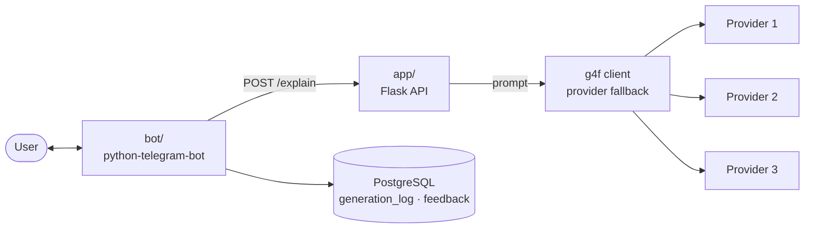
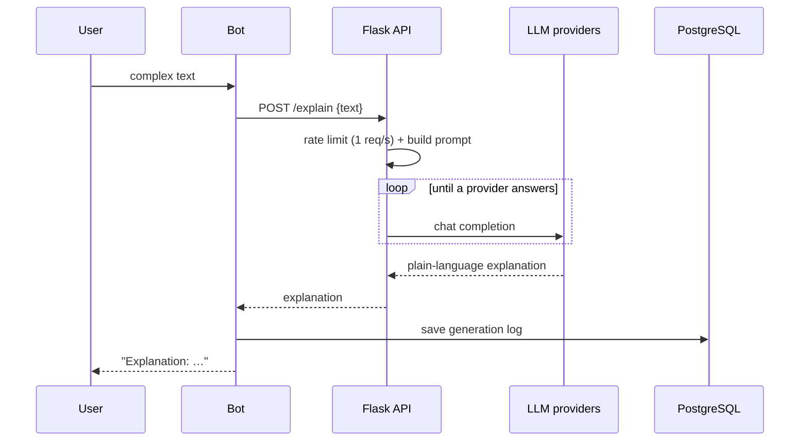

# explainit — "explain it simply" Telegram bot

A Telegram bot that takes a piece of complex text and explains the hard terms in plain language, as if to a friend — with simple examples, no jargon, and a strict format. It logs every generation and collects user feedback.

## Architecture



## Request flow



## Features

- Plain-language explanations with a fixed output format
- LLM access through g4f with automatic fallback between providers
- Rate limiting and request locking on the API
- Menu: premium, podcast, feedback, donation
- Generation logs and user feedback stored in PostgreSQL (SQLAlchemy)

## Run

```bash
cp .env.example .env             # BOT_TOKEN and POSTGRES_PASSWORD
docker compose up -d --build     # PostgreSQL, API and bot
```

## Stack

Python, python-telegram-bot, Flask, g4f, PostgreSQL, SQLAlchemy, Docker Compose.
